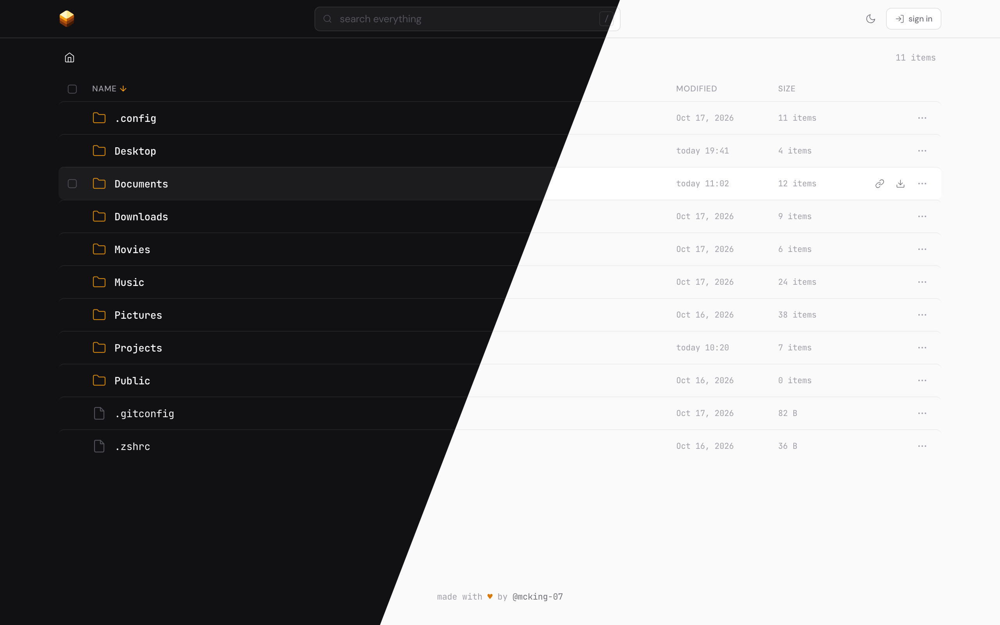

# dufs-strata

[](https://github.com/sigoden/dufs)
[](https://github.com/mcking-07/dufs-strata/actions/workflows/release.yml)
[](https://github.com/mcking-07/dufs-strata/releases/latest)
[](https://opensource.org/licenses/MIT)

a minimal, elegant, and configurable theme for [dufs](https://github.com/sigoden/dufs).



## features

- browse, sort by name / modified / size, and search (`/` to focus)
- previews for images, video, audio, pdf, markdown, and text / code with syntax highlighting; `←` `→` step through files, `esc` closes
- edit text files in place: `⌘/ctrl-s` saves, `tab` / `shift-tab` indent, unsaved changes are guarded
- upload files or whole folders by dropping them anywhere on the page
- large uploads are sent in chunks and resume automatically after a dropped connection
- new file, new folder, rename, delete, copy link, sha-256, zip download
- multi-select with bulk download and delete
- dark and light themes, following the visitor's device by default
- built for phones too: bottom sheets, long-press to select, touch-sized controls
- customize colours, fonts, logo and text with a `config.json` next to `index.html`; no build step

## requirements

- dufs **0.46** or newer
- works at the root of the host or under dufs `--path-prefix`

## installation

download `dufs-strata.zip` from the [latest release](https://github.com/mcking-07/dufs-strata/releases/latest), extract it into your themes folder and point dufs at it:

```sh
mkdir -p ~/.config/dufs/themes && cd ~/.config/dufs/themes

curl -fsSLO https://github.com/mcking-07/dufs-strata/releases/latest/download/dufs-strata.zip
unzip dufs-strata.zip && rm dufs-strata.zip

dufs --assets ~/.config/dufs/themes/strata /path/to/share
```

or in a dufs config file:

```yaml
assets: /home/you/.config/dufs/themes/strata
```

dufs reads `index.html` at startup, so restart it after replacing that file.

## customisation

the released `config.json` lists every option with its default value. edit what you want to change:

```text
$HOME/.config/dufs/themes/strata/
├── index.html
├── config.json      every option, set to the defaults
└── logo.svg         optional, when config.json points to it
```

changes apply on the next page load: no rebuild, no dufs restart.

anything you delete falls back to the built-in default, so the smallest config is just the keys you changed:

```json
{
  "title": "files",
  "footer": false,
  "colors": { "dark": { "accent": "#3b82f6" }, "light": { "accent": "#2563eb" } }
}
```

trimming it this way is worth it: keys you leave in stay pinned to the values in your file, so you won't pick up default tweaks from future releases.

| key                           | what it does                                                                                                                                                                                                      |
| ----------------------------- | ----------------------------------------------------------------------------------------------------------------------------------------------------------------------------------------------------------------- |
| `title`                       | tab title at the root folder                                                                                                                                                                                      |
| `theme`                       | `"system"` (default: follow the visitor's device, dark if it has no preference), `"dark"` or `"light"`. visitors who pick a mode with the toggle keep their choice                                                |
| `footer`                      | `{ "text", "label", "href" }`, or `false` to hide it. a `♥` in `text` is drawn in the accent colour                                                                                                               |
| `fonts.sans`, `fonts.mono`    | css font stacks                                                                                                                                                                                                   |
| `fonts.google`                | load the first family of each stack from google fonts. set `false` for system fonts                                                                                                                               |
| `colors.dark`, `colors.light` | palette for each mode: `bg`, `surface`, `elevated`, `border`, `text`, `muted`, `dim`, `accent`, `on_accent` (text on accent-filled buttons), `red`, `green`. colours are `#rrggbb`                                |
| `logo`                        | `"auto"` colours the built-in cube from `colors.dark.accent`. a file name next to `index.html` (`"logo.svg"`) replaces it in the header and the favicon. or six `#rrggbb` tones for the cube, darkest to lightest |
| `upload.chunk_size`           | files above this many bytes upload in chunks. the default of 64 MiB stays under cloudflare's 100 MB request limit                                                                                                 |

an unknown key or an invalid value is ignored on its own: that key uses its default, everything else still applies, and the page shows what was ignored, for example `config.json: ignored colors.dark.acent (unknown key)`.

- dufs serves everything in the theme folder **without authentication**. keep only theme files there.
- `config.json` itself is optional. without it, everything uses the defaults and the browser console logs one harmless 404 per page load.

## build from source

```sh
npm ci
npm run build

dufs --assets ./dist /path/to/share
```

this writes `dist/index.html` and `dist/config.json` (generated from the defaults in the code). requires node 20.19 or newer. `npm run ci` runs the format check, lint and build.

## notes

- admin sign-in uses dufs's own auth (`-a user:pass@/:rw`). credentials are kept in `sessionStorage` for the tab, never in `localStorage`.
- chunked uploads write to a hidden `.<name>.<size>.part` file next to the target and move it into place when finished. hide dot files (`--hidden '.*'`) so partial uploads never show up in listings.
- videos the browser can't play (most `.mkv`) fall back to a download button and an "open in vlc" link.

## license

[MIT](LICENSE)
